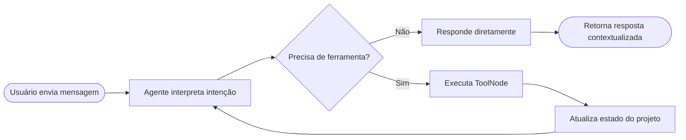

<h1 align="center">🤖 AcademicFlow-Agent</h1>

<p align="center">
  Agente colaborativo de IA com arquitetura ReAct para planejamento de eventos acadêmicos.
</p>

<p align="center">
  
  
  
  
  
  
</p>

---

## 💡 Sobre o Projeto

O **AcademicFlow-Agent** é um sistema colaborativo inteligente que utiliza o padrão **ReAct (Reason + Act)** para auxiliar equipes no planejamento de eventos acadêmicos. O agente analisa mensagens de múltiplos participantes, decide autonomamente quando acionar ferramentas e mantém o quadro do projeto sincronizado em tempo real.

### 🎯 Destaques do Projeto

- **Arquitetura de Agentes ReAct**: Orquestração orientada a grafos de estado (`StateGraph`) com tomada de decisão dinâmica.
- **Tool Calling Autônomo**: O modelo decide em tempo de execução quando registrar tarefas, atualizar status, documentar decisões ou consultar o quadro.
- **Interface Web & CLI**: Interface interativa em Streamlit com suporte a múltiplos participantes, painel de estado lateral e rastreamento de ferramentas acionadas.
- **Privacidade & Execução Local**: Integração com Ollama (`llama3.2`), permitindo inferência local sem custos de API.
- **Cobertura de Testes Automatizados**: Suíte com `pytest` validando as ferramentas de colaboração e o ciclo completo do grafo ReAct via mocks (sem necessidade de GPU/Ollama em CI).

---

## ⚙️ Arquitetura

O sistema foi construído como um **State Graph** no LangGraph, seguindo o ciclo ReAct:



| Componente | Tecnologia | Função |
|:-----------|:-----------|:-------|
| Orquestração | LangGraph | Grafo de estados (`MessagesState`) com ciclos de decisão |
| LLM | Ollama + Llama 3.2 | Raciocínio determinístico (`temperature=0`) e geração de respostas |
| Ferramentas | LangChain Tools | Gestão de tarefas, decisões e seções do documento colaborativo |
| Interface | Streamlit & CLI | Interação multiusuário, visualização do quadro e badges de execução |

---

## 🚀 Funcionalidades

| Funcionalidade | Ferramenta (`@tool`) | Descrição |
|:---------------|:---------------------|:----------|
| 📋 Registro de tarefas | `register_task` | Cria tarefas com título, responsável, prazo e status inicial |
| 🔄 Atualização de tarefas | `update_task` | Atualiza status (ex.: `concluida`), responsável ou prazo de uma tarefa |
| ✅ Registro de decisões | `register_decision` | Armazena decisões importantes tomadas pelo grupo e suas justificativas |
| 📄 Documento colaborativo | `update_document_section` | Cria e atualiza seções estruturadas do plano do evento |
| 📊 Quadro do projeto | `consult_project_board` | Sintetiza o estado completo de tarefas, decisões e documentos |

---

## 🏗️ Estrutura do Projeto

```text
AcademicFlow-Agent/
├── assets/
│   └── logo.png                       # Identidade visual exibida na interface
├── docs/
│   └── TEST_TEMPLATES.md              # Roteiros de testes manuais e de aceitação
├── src/
│   ├── __init__.py
│   ├── agent.py                       # Agente ReAct principal e grafo LangGraph
│   └── ui.py                          # Interface web colaborativa em Streamlit
├── tests/
│   ├── conftest.py                    # Fixtures de isolamento de estado
│   ├── test_agent_configuration.py    # Testes de configuração e fluxo do grafo ReAct
│   └── test_collaboration_tools.py    # Testes unitários das ferramentas do agente
├── requirements.txt                   # Dependências de execução
├── requirements-dev.txt               # Dependências de desenvolvimento e testes
└── README.md
```

---

## 🛠️ Como Executar

**Pré-requisitos:** Python 3.10+ e [Ollama](https://ollama.com) instalado.

```bash
# 1. Clone o repositório
git clone https://github.com/Pedrosasouza/AcademicFlow-Agent.git
cd AcademicFlow-Agent

# 2. Instale as dependências
pip install -r requirements.txt

# 3. Baixe e inicie o modelo LLM no Ollama
ollama pull llama3.2
ollama serve
```

### Opção A — Interface Web (Streamlit)
```bash
streamlit run src/ui.py
```

### Opção B — Interface de Linha de Comando (CLI)
```bash
python src/agent.py
```

> **Configuração opcional via variáveis de ambiente:**
> - `OLLAMA_MODEL` (padrão: `llama3.2`)
> - `OLLAMA_BASE_URL` (padrão: `http://localhost:11434`)

---

## 🧪 Testes

A suíte automatizada valida todas as ferramentas e o roteamento do grafo ReAct sem exigir uma instância ativa do Ollama:

```bash
pip install -r requirements-dev.txt
pytest tests/ -v
```

Os roteiros de testes manuais e de aceitação estão documentados em [`docs/TEST_TEMPLATES.md`](docs/TEST_TEMPLATES.md).

---

## 📚 Aprendizados

- Construção de **agentes autônomos** com ciclos de raciocínio e ação (ReAct)
- Orquestração de fluxos conversacionais com **grafos de estado** (LangGraph)
- Integração de **LLMs locais** com chamadas determinísticas de ferramentas (Tool Calling)
- Engenharia de **testes unitários e de integração com mocks** para sistemas baseados em IA

---

## 📝 Licença

Este projeto é de uso acadêmico e pessoal.

---

<p align="center">
  Desenvolvido por <a href="https://github.com/Pedrosasouza"><strong>Pedro Santos Souza</strong></a> · USP São Carlos
</p>
